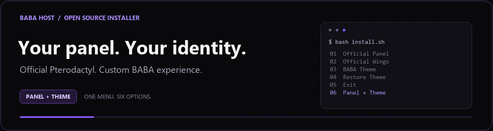
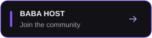
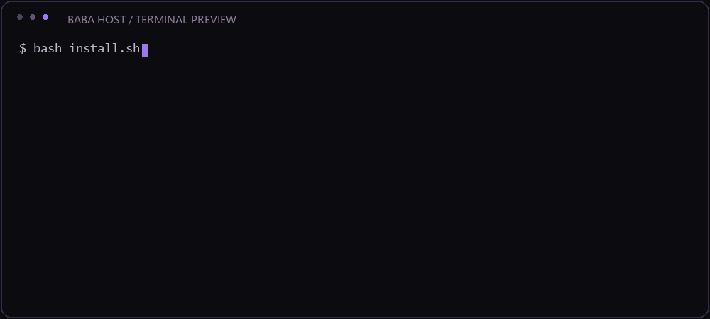

<div align="center">



**A clean setup. A familiar panel. A look of your own.**

Official Pterodactyl Panel and Wings. Custom BABA HOST theme. One simple menu.

[](https://github.com/ahirwarprashant8595-dotcom/Petro-theme-By-Baba/actions/workflows/verify.yml)


<a href="https://discord.gg/babahost"></a>
<a href="https://discord.gg/E2qctRDZm"></a>

[Fresh VPS](#fresh-vps-panel--theme) · [Existing panel](#existing-panel-theme-only) · [Menu](#interactive-menu) · [Wings](#connect-wings) · [Help](#troubleshooting)

</div>

---

Install Pterodactyl **1.15.2** with BABA HOST, or apply only the theme to an existing compatible panel. Theme snapshot: **5 November 2026**. This community installer is independent of the Pterodactyl project.

## Interactive menu



*Menu preview. Real installation progress follows the commands actually running.*

Purple terminal styling, a brief welcome reveal and live activity indicators make the installer easier to follow. Installation stages stay visible, and failures keep their error output. Piped output uses plain text.

Run without arguments:

```bash
bash install.sh
```

Prefer a static terminal? Disable motion, or colours and motion together:

```bash
BABA_MOTION=0 bash install.sh
```

```bash
NO_COLOR=1 bash install.sh
```

| Option | Action | When to use it |
|:---:|---|---|
| **1** | **Install Panel** | Official Panel 1.15.2 with its default interface. |
| **2** | **Install Wings** | Official Wings 1.13.4; Docker is installed if missing. |
| **3** | **Install Theme** | Add BABA HOST to an existing compatible panel. |
| **4** | **Remove Theme** | Select a saved backup and restore the previous appearance. |
| **5** | **Exit** | Leave without starting an installation. |
| **6** | **Install Panel + Theme** | Set up the panel and BABA HOST together. |

Wings requires node YAML generated from your own panel and the correct certificates. Provide a local YAML file during installation, or configure it afterwards. Without configuration, only the binary and service are installed; it is not falsely reported as connected. Existing Wings binaries/services are not overwritten. Downloaded official binaries are checked against pinned SHA-256 values.

Theme removal restores the backup you select, including its prior settings and replaced files. It does not delete your panel, accounts or servers. With no matching backup it refuses removal. If multiple theme installs were made, choose the backup from before the first theme install to restore the original appearance.

## Fresh VPS: Panel + theme

Supported: **Ubuntu 22.04 / 24.04 or Debian 12**, root access, systemd and a domain pointing to your VPS. Start on a dedicated fresh VPS. Ports 80/443 must be reachable for HTTPS. Install Git first if it is missing (`apt-get update && apt-get install -y git`).

Run each command **one at a time**, as root.

**Step 1 — Install Git**

```bash
apt-get update
```

```bash
apt-get install -y git
```

**Step 2 — Download the installer**

```bash
git clone https://github.com/ahirwarprashant8595-dotcom/Petro-theme-By-Baba.git
```

**Step 3 — Open its folder**

```bash
cd Petro-theme-By-Baba
```

**Step 4 — Open the animated menu**

```bash
bash install.sh
```

**Step 5 — Choose your installation**

Enter **6** for Panel + Theme, or **1** for the official Panel interface. The next prompts collect your domain and administrator details.

Choose HTTPS when your domain is ready, then type `INSTALL`. Setup configures PHP, MariaDB, Redis, NGINX, the administrator, scheduler and queue worker, plus the theme if selected. Package, frontend, application and service checks run before completion. Password entry is hidden and is not passed as a command-line argument.

After installation, open your panel domain and sign in with the administrator account you created. To reopen the menu later, run these commands inside the repository folder:

```bash
git pull --ff-only
bash install.sh
```

Fresh mode refuses an existing panel, existing BABA Panel service configuration, other NGINX sites or an existing `baba_panel` database/user. A failed installation leaves partial files for inspection rather than deleting data. It does not automatically roll back OS packages, database creation or certificates; do not rerun over a partial installation without reviewing it.

**Wings is option 2.** To host game servers, create/configure your node, allocations and Eggs and supply its node configuration to Wings. The installer cannot generate your node configuration without your panel credentials. Configure SMTP in Administration > Settings; until then mail is logged locally. DNS, firewall and any reverse proxy must be configured correctly. Telemetry is disabled by default.

## Existing panel: theme only

For an already working **Pterodactyl 1.15.2** panel, run these separately. Skip the clone step if this repository is already downloaded.

**Step 1 — Download**

```bash
git clone https://github.com/ahirwarprashant8595-dotcom/Petro-theme-By-Baba.git
```

**Step 2 — Open the installer folder**

```bash
cd Petro-theme-By-Baba
```

**Step 3 — Check compatibility without changing the panel**

```bash
bash install.sh theme /var/www/pterodactyl --check
```

**Step 4 — Apply the theme**

```bash
bash install.sh theme /var/www/pterodactyl
```

**Step 5 — Verify the installed theme**

```bash
bash install.sh verify /var/www/pterodactyl
```

Use `--keep-branding` instead of `--check` to retain target panel theme settings. Otherwise BABA HOST branding is applied. Source and compiled frontend are included, so Node/Yarn is not required to apply the theme. No accounts, server files, node settings, `.env`, credentials or database dumps are distributed.

Open **Administration → Edit Theme** to manage colours, branding and artwork. Refresh your browser with `Ctrl+Shift+R` after installation.

Theme installation backs up overwritten files/settings to `/var/backups/theme-by-baba-*`, applies the additive Egg artwork migration, refreshes caches and runs verification. It preserves existing panel accounts and servers. Review other custom modifications before applying a theme overlay.

## Connect Wings

Choose **2** in the menu, then:

1. Create a node in **Administration → Nodes**.
2. Save its **Configuration** YAML to a local file on the Wings VPS.
3. Supply that file path to the installer, or configure `/etc/pterodactyl/config.yml` afterwards.
4. Configure node certificates, firewall and allocations for your setup.

After configuring manually, start Wings and inspect its service:

```bash
systemctl enable --now wings
systemctl status wings --no-pager
journalctl -u wings -n 50 --no-pager
```

The configuration must come from your own panel. A running service still needs successful connectivity to it.

## Verify / restore

```bash
bash install.sh verify /var/www/pterodactyl
```

For theme rollback, use the exact backup path printed by installation:

```bash
bash /var/backups/theme-by-baba-XXXXXXXX/restore.sh /var/backups/theme-by-baba-XXXXXXXX
```

The additive Egg artwork database columns remain after theme rollback. Back up your panel `.env` and database securely as well. Theme rollback is not a fresh-panel uninstall.

Administration > Edit Theme manages branding. Optional runtime Egg definitions are inside the theme archive's `eggs/` folder. Import them through Administration > Nests. Minecraft live player/inventory/map features require the included MC bridge on a compatible Paper/Spigot server; installing a theme alone cannot supply live game data.

## Package / tests

`Theme-By-Baba-1.4.0.tar.gz` contains theme source, built assets, configuration, theme installer/restore script and upstream license notices. `PACKAGE.sha256` covers the archive and installer helpers. `UPSTREAM.json` records the pinned official Panel release and checksum.

```bash
bash tests/check-package.sh
```

See [VERIFICATION.txt](VERIFICATION.txt) for checks actually completed. Syntax/preflight and live snapshot checks do not prove a fresh VPS install. See [NOTICE.md](NOTICE.md) for upstream/artwork ownership. Do not commit `.env`, keys, databases, logs or server backups.

**Full fresh-VPS Panel/Wings provisioning has not been tested end to end.**

## Troubleshooting

<details>
<summary><strong>The installer says a panel already exists</strong></summary>

Use option **3** for an existing compatible panel. Fresh mode refuses a nonempty panel directory or conflicting configuration. Inspect partial failed installations before changing files.

</details>

<details>
<summary><strong>HTTPS certificate setup failed</strong></summary>

Check domain DNS, ports 80/443, proxy settings and the certificate error. Do not reinstall the whole panel just to retry a certificate request.

</details>

<details>
<summary><strong>The theme still looks unchanged</strong></summary>

Hard refresh with `Ctrl+Shift+R`, inspect Administration → Edit Theme, then run the installed-theme verification command above.

</details>

<details>
<summary><strong>Wings is installed but the node is offline</strong></summary>

Check the node YAML, certificates, firewall and Wings logs. Do not share node tokens publicly.

</details>

<details>
<summary><strong>Emails are not sending</strong></summary>

Configure SMTP in Administration → Settings. Fresh installations log mail locally until delivery is configured.

</details>

## Community and support

**BABA HOST:** [discord.gg/babahost](https://discord.gg/babahost)  
**Installer support:** [discord.gg/E2qctRDZm](https://discord.gg/E2qctRDZm)

Include your OS, selected option and error when asking for help. Remove passwords, node tokens and private configuration from anything you share.

---

<div align="center">

**BABA HOST · Made for your next server.**

[Community](https://discord.gg/babahost) · [Support](https://discord.gg/E2qctRDZm) · [Notices](NOTICE.md) · [Pinned versions](UPSTREAM.json)

</div>

Official references: [Panel installation](https://docs.pterodactyl.io/v1/panel/getting-started), [web server](https://docs.pterodactyl.io/v1/panel/webserver-configuration).
